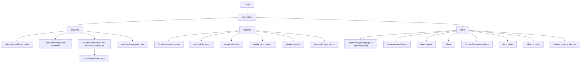
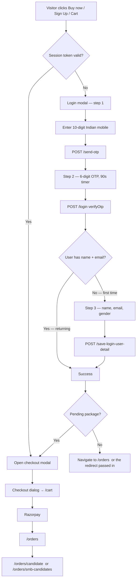
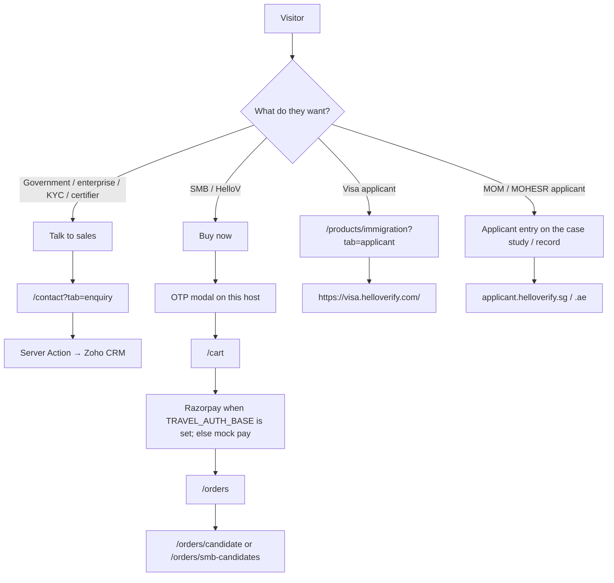

# Old vs new — route flow and login / signup

**Status (5 Oct 2026):** Parts 1–12 of `[ROUTE-LOGIN-TASKS.md](./ROUTE-LOGIN-TASKS.md)` are done. The **old URL tree and login** are back on this host. The new design and SEO stay. Home, `/landing-page`, and `/ai` were not rewritten. Measured: `npm test` 1385 passed; `probe:redirects` against a production build — PASS, 831 assertions.

**Old site:** `D:\Projects\Application Frontend HV` (Vite + React Router SPA)
**New site:** this repo — `helloverify-web` (Next.js)
**Companion:** `[INFORMATION-ARCHITECTURE.md](./INFORMATION-ARCHITECTURE.md)` §9 · `[BUILD-SPEC.md](./BUILD-SPEC.md)` §2 · `helloverify-web/src/lib/seo/legacy-urls.ts`

Every public URL below is locale-prefixed. Both sites do `/` → `/en` (or the visitor's locale). Paths are written without the prefix; in the browser they are `/en/…`, `/hi/…`, `/ar/…`.

---

## 1. The one-line difference

The old website is **two products in one host**: marketing pages **and** a logged-in shop (cart, OTP login, Razorpay, orders), plus authority applicant entry on MOM / MOHESR.

The new website is **that again**: new design at the **old SPA paths**, OTP + cart + pay on www, MOM / MOHESR applicant entry on those pages. Only leftover hops off www are the old payment-callback / password-recovery URLs (`app.helloverify.com`) and visa screening (`visa.helloverify.com`).

```
OLD (one host)                         NEW (one host again)
─────────────────                      ────────────────────────────────
www.helloverify.com                    www.helloverify.com
  /en                                    /en
  /en/products/hellov                    /en/products/hellov   (new design)
  /en/cart          ← OTP                /en/cart              ← OTP
  /en/orders        ← OTP                /en/orders            ← OTP
                                         visa.helloverify.com  visa applicant
                                         app.helloverify.com   PayU + password recovery only
```

Header **Sign Up** opens the OTP modal. **Buy now** on HelloV / SMB is `CommerceCta` (OTP → add-to-cart → `/cart`), not a link to `app.helloverify.com`.

---

## 2. Old website — how a visitor moves

### 2.1 Locale and layout

```
/  →  /en
/:lang/*  →  SiteLayout (header + footer + auth modals)
unmatched →  /:lang  (locale home)
unknown locale →  /en
```

Source: `Application Frontend HV/src/App.tsx`.

Header (CMS `globals.base.json`):

```
Solutions ▾   Products ▾   Premium Services ▾   About Us   Support ▾   Technology
                                                         [Talk to sales]  [EN ▾]
```

**Sign Up** is in the CMS (`label: "Sign Up"`) but the button is **commented out** in `Navbar.tsx`. If a session exists, a user menu appears instead (Cart / Orders / Profile / Logout).

### 2.2 Public marketing routes (what actually renders)



Mega-menu destinations that are **not** their own page:

| Menu item | Where it goes |
| --- | --- |
| Consumer → Verify Individuals | `/#consumer-services` (homepage anchor) |
| Premium → Health practitioners | **no `href`** in CMS — dead item |
| Premium parent | `/contact?tab=enquiry` |
| Support | `/contact?tab=enquiry` |

Duplicates on purpose: `/enterprise` and `/products/bgv-enterprise` mount the **same** `EnterprisePage`. `/products/immigration` and `/solutions/immigration-authorities` mount the **same** `ImmigrationMigrationServicePage`.

### 2.3 Old redirects (client-side `<Navigate>`, not HTTP 308)

These URLs exist only so old links do not 404. The browser still first loads the SPA.

| Typed URL | Lands on |
| --- | --- |
| `/signup` | `/contact?tab=enquiry` |
| `/smb` | `/products/bgv-smb` |
| `/kyc` | `/products/customer-kyc` |
| `/products/trust-safety` | `/products/customer-kyc` |
| `/solutions` | home |
| `/products` | home |
| `/solutions/business-trade` | `/solutions/trade-authorities` |
| `/premium` | `/contact?tab=enquiry` |
| `/premium/immigration-applicant` | `/products/immigration?tab=applicant` |
| `/premium/consumer-service` | `/products/hellov` |
| `/consumer`, `/consumer/basic`, `/consumer/premium` | `/products/hellov` |
| `/visa-screening` | `/products/immigration` |
| `/support`, `/support/enquiry`, `/support/track` | `/contact?tab=enquiry` |
| `/premium/saudi` | home (page hidden) |
| `/premium/health-practitioners` | home (page hidden) |
| `…/educationae` (MOHESR) | home (hidden until AE go-live) |
| `/cartlist` | `/cart` |

**`/signup` is not a signup page.** It is a sales-enquiry alias.

### 2.4 Logged-in app routes (same host, `ProtectedRoute`)

```
/cart
/orders
/orders/candidate          travel / visa candidate form
/orders/smb-candidates     SMB invite flow
/orders/profile-settings
/profile-settings
```

If there is no session:

1. Redirect to `/:lang` (home)
2. Open the login modal with `redirect: 'orders'`

Source: `src/components/auth/ProtectedRoute.tsx`.

---

## 3. Old website — login / signup

There is **no `/login` page** and **no `/register` page**. Auth is a modal. Three different systems use the word "sign up".

### 3.1 Consumer login = signup (one OTP dialog)

Used by: header Sign Up (when un-hidden), **Buy now / Add to cart**, HelloV packages, SMB packages, and any hit on `/cart` or `/orders` while logged out.

Source: `src/components/auth/LoginDialog.tsx` · API: `TRAVEL_AUTH_API/send-otp` then `/login`.



What this means in product terms:

- **Login and signup are the same flow.** First OTP on a new number becomes registration (step 3). Returning number skips step 3.
- Session lives in `localStorage` (`currentUser` + auth token). `isLoggedIn` is `hasValidAuthToken()`.
- After login the header shows **Cart / My orders / Profile settings / Logout**.
- Default post-login landing is **`/orders`**, not home.

Buy-now wiring (`CommerceCtaButton.tsx`):

```
logged in  → openCheckout(package)
logged out → openLogin({ redirect, afterLoginCheckout: package })
             after OTP success → openCheckout(package)
```

### 3.2 `/signup` URL (not auth)

```
/:lang/signup  →  /:lang/contact?tab=enquiry
```

This is a **lead form**, not an account. Same destination as Talk to sales and Support.

### 3.3 Authority applicant login (separate product)

Used on old MOM / MOHESR / (hidden) Saudi pages. Modal: `SaudiIndividualAuthDialog`.

| Authority | Marketing page | After login they leave www |
| --- | --- | --- |
| Singapore MOM | `/solutions/…/ministry-of-manpower` | `applicant.helloverify.sg` / `agency.helloverify.sg` |
| UAE MOHESR | `/solutions/…/educationae` (redirects home on the old SPA) | `applicant.helloverify.ae` + UAE PASS QR signup |
| KSA health | `/premium/saudi` (redirects home) | `applicant.helloverifyksa.com` / `agency.helloverifyksa.com` |

This is **email + password + OTP** (or a "go to portal" card), not the consumer mobile OTP. It talks to `api.helloverify.sg` / `.ae` / `api.helloverifyksa.com`. It does **not** create a www cart session.

MOHESR also has a **UAE PASS "Sign Up now"** QR dialog (`UaePassSignUpQrDialog`) — third-party identity, not HelloVerify's consumer account.

### 3.4 External logins the old site only *points at*

Visa applicant copy tells people to log in at `https://visa.HelloVerify.com` (Visa Screening / Candidate Login). That host is outside this SPA.

---

## 4. New website — how a visitor moves

### 4.1 What is shipped

Implemented pages live under `helloverify-web/src/app/[locale]/`. Manifest: `src/lib/seo/routes.ts`. **Old SPA marketing paths are the live ones** (Part 1). Audience-first verticals 308 onto those. Hubs stay.

```mermaid
graph TD
    R["/ → locale negotiation → /en"] --> H["/:locale  Home"]

    H --> GOV["/governments  hub"]
    H --> BIZ["/business  hub"]
    H --> IND["/individuals  hub"]
    H --> PLT["/platform  hub"]
    H --> RES["/resources  hub"]

    GOV --> SH["/solutions/health-authorities"]
    GOV --> SI["/solutions/immigration-authorities"]
    GOV --> SM["/solutions/manpower-and-education-authorities"]
    GOV --> ST["/solutions/trade-authorities"]
    SI --> GL["/governments/immigration/embassy-of-latvia"]
    SI --> GIT["/governments/immigration/embassy-of-italy"]
    SM --> MOM["…/ministry-of-manpower"]
    SM --> MOH["/governments/manpower-education/mohesr"]

    BIZ --> PE["/products/bgv-enterprise"]
    BIZ --> PS["/products/bgv-smb"]
    BIZ --> EMP["/employee-verification"]
    BIZ --> PK["/products/customer-kyc"]
    BIZ --> PC["/products/certifier"]

    IND --> PH["/products/hellov"]
    IND --> PI["/products/immigration"]
    IND --> IF["/individuals/home-family"]

    PLT --> TEC["/technology"]
    PLT --> INT["/international"]
    PLT --> PSEC["/platform/security-compliance"]
    PLT --> AI["/ai"]

    RES --> RB["/resources/blog + slugs"]
    RES --> RC["/resources/checks"]
    RES --> RCO["/resources/countries"]
    RES --> RG["/resources/glossary"]
    RES --> CHK["/checks/:check"]
    RES --> CTY["/countries/:country"]

    H --> AB["/about"]
    H --> CT["/contact?tab=enquiry|track"]
    H --> LEG["/legal/:slug"]
    H --> CART["/cart  /orders  /profile-settings"]
```



**New-only pages** (no old first-class URL): audience hubs, `/individuals/home-family`, `/governments/manpower-education/mohesr`, embassy pages, `/platform/security-compliance`, `/ai`, `/checks/*`, `/countries/*`, `/resources/glossary`, extra legal slugs.

Locales served: **en, hi, ar**.

### 4.2 Header

```
Solutions ▾   Products ▾   Premium services ▾   About   Support ▾   Technology
                                    [Sign Up]  [locale]  [Talk to sales]
```

Labels are still the old words. **Hrefs are the old SPA paths** (a card on `/governments` goes to `/solutions/health-authorities`, not `/governments/health`). Sign Up opens the OTP modal. After login the header shows Cart / Orders / Profile / Logout.

`INFORMATION-ARCHITECTURE.md` still proposes renaming the six items to Governments / Business / Individuals / Platform / Resources. That label change is **not shipped**.

### 4.3 Conversion — login is back on www



| Action | This host does |
| --- | --- |
| Talk to sales | `/contact?tab=enquiry` — Zoho Server Action |
| Track | `/contact?tab=track` — three methods, **no case API** (old `TrackPanel` was the same) |
| Sign Up / Buy now | OTP modal → sessionStorage (`currentUser` / `authToken` / `refreshToken`) |
| HelloV / SMB | `CommerceCta` → checkout → `/cart` → pay → `/orders` → invite |
| Immigration applicant | visa portal, not the www cart |
| MOM / MOHESR | Register / Login / UAE PASS as on the old pages; does **not** write the www cart session |
| `/signup` | **308** → `/contact` (enquiry default) |
| `/en/cart`, `/en/orders`, `/en/profile-settings`, invite URLs | **200** on this host |

---

## 5. Same routes — how old URLs survive

Server **308s** in `legacy-urls.ts` (not JS `<Navigate>`).

### 5.1 Audience-first path → old path (same host)

The rebuild invented `/business/enterprise`, `/governments/health`, … Those 308 onto the old App.tsx path, which is the 200.

| Typed (308 away) | Live (200) |
| --- | --- |
| `/business/enterprise` | `/products/bgv-enterprise` |
| `/business/smb` | `/products/bgv-smb` |
| `/business/employee-verification` | `/employee-verification` |
| `/business/customer-kyc` | `/products/customer-kyc` |
| `/business/certifier` | `/products/certifier` |
| `/governments/health` | `/solutions/health-authorities` |
| `/governments/immigration` | `/solutions/immigration-authorities` |
| `/governments/manpower-education` | `/solutions/manpower-and-education-authorities` |
| `…/ministry-of-manpower` (audience prefix) | same under `/solutions/…` |
| `/governments/trade` | `/solutions/trade-authorities` |
| `/individuals/hellov` | `/products/hellov` |
| `/individuals/immigration` | `/products/immigration` |
| `/platform/technology` | `/technology` |
| `/platform/coverage` | `/international` |

Old aliases still match App.tsx:

| Typed | Lands on |
| --- | --- |
| `/enterprise` | `/products/bgv-enterprise` |
| `/smb` | `/products/bgv-smb` |
| `/kyc`, `/products/trust-safety` | `/products/customer-kyc` |
| `/solutions/business-trade` | `/solutions/trade-authorities` |
| `/consumer`, `/consumer/basic`, `/consumer/premium`, `/premium/consumer-service` | `/products/hellov` |
| `/visa-screening` | `/products/immigration` |
| `/premium/immigration-applicant` | `/products/immigration?tab=applicant` |
| `…/educationae` | `/governments/manpower-education/mohesr` |
| `/signup`, `/support`, `/support/enquiry`, `/support/track`, `/premium` | `/contact` |
| `/cartlist` | `/cart` |
| `/blog`, `/blog/<slug>` | `/resources/blog…` (IA canonical; do not invert) |
| `/privacy-policy` etc. | `/legal/…` |
| `/terms-and-conditions` | `/legal/terms-of-service` |
| `/premium/saudi`, `/premium/health-practitioners` | home (still no page) |
| `/about`, `/contact` | unchanged |

Unprefixed and `/index.html` forms are 308'd in one hop.

### 5.2 Paths that still leave www

| On www | Goes to |
| --- | --- |
| `/consumer/passwordrecovery/:token` | `https://app.helloverify.com` (same path) |
| `/consumer/PayUPayment/PaymentSuccess1` | same host, 308 keeps POST |
| Immigration "Screen my documents" | `https://visa.helloverify.com/` |

`/cart`, `/orders`, `/orders/candidate`, `/orders/smb-candidates`, `/profile-settings` stay on this host.

---

## 6. What is actually different

### Routes

| | Old | New |
| --- | --- | --- |
| Design / SEO | Vite SPA | Next, new design, answer blocks, sitemap. Home / `/landing-page` / `/ai` untouched. |
| Live marketing URL | Old App.tsx path | **Same path** |
| Audience-first URL | Did not exist | 308 onto the old path |
| Hubs | `/solutions` and `/products` dumped to home | Real pages at `/governments`, `/business`, `/individuals`, `/platform`, `/resources` |
| Consumer | Homepage hash `/#consumer-services` | `/individuals` + `/individuals/home-family` |
| Hidden authority pages | Saudi + `educationae` → home | MOHESR live; `educationae` → that page. Saudi still home. |
| Immigration tabs | Same page, `?tab=applicant` | Tabs link the two live verticals; query after mount |
| Redirect quality | Client JS (Google often saw a 200) | Real HTTP 308 |
| Unmatched URL | Soft-land on home | 404 (legacy table covers known old paths) |

### Login / signup / money

| | Old | New |
| --- | --- | --- |
| Account on www | OTP modal, `localStorage` | OTP modal, **`sessionStorage`** (same key names) |
| Header Sign Up | Built, often hidden | **Shipped** — opens the modal |
| Buy now | In-page login → checkout → Razorpay | Same, via `CommerceCta` |
| Cart / orders / profile / invite | Same origin | Same origin |
| Contact | Tabs: enquiry + track (track was a no-op) | Same pair; track stays honest (no case API) |
| MOM / MOHESR apply | In-page login/register → portal | Restored on those pages |
| Visa applicant | `visa.helloverify.com` | Same host — not the www cart |
| Payment on www | Razorpay + travel-auth in the SPA bundle | Razorpay only when `TRAVEL_AUTH_BASE` is set; otherwise mock pay |

### Restored flows

```
HelloV / SMB
  page → Buy now → OTP → checkout → /cart → pay → /orders → invite

MOM
  page → Proceed as individual → email/OTP register → applicant.helloverify.sg

MOHESR
  page → Login / Register / UAE PASS → applicant.helloverify.ae

Immigration applicant
  /products/immigration?tab=applicant → visa.helloverify.com
```

---

## 7. What is still not the old SPA

| Old behaviour | Status |
| --- | --- |
| Session in `localStorage` | `sessionStorage` on purpose (closes a XSS persistence hole). Same keys. |
| `/contact?tab=track` looks up a case | Still does not. Old `TrackPanel` never called an API. |
| `/premium/saudi` | Still home — no Saudi page. |
| Nav labels Governments / Business / … | Not shipped. Old Solutions / Products labels, old hrefs. |
| Homepage section hrefs | May still name audience-first paths; those 308 to the old URL. |
| Password recovery / PayU return | Still 308 to `app.helloverify.com`. That host must be live before anyone hits those URLs — a 308 is cached forever. |

---

## 8. Cutover env

Names and unset behaviour are in `helloverify-web/.env.example`. Nothing here is a secret.

| Variable | Unset (dev / default) | Live |
| --- | --- | --- |
| `TRAVEL_AUTH_BASE` | Mock OTP `123456`. Mobile `9111111111` is first-time. Cart / orders / invite live in sessionStorage. | Proxy `send-otp` / `login` / cart / payment-init / payment-callback / order-list / travel + SMB invite. CSP admits `checkout.razorpay.com`. |
| `TRAVEL_AUTH_MOCK` | — | `1` forces mock even when the base is set. |
| Razorpay key | None on www. Mock pay writes the order in sessionStorage. | Comes back from **payment-init** on the travel host. There is no `RAZORPAY_*` env on this app. |
| `AUTHORITY_API_LIVE` | Mock OTP `123456`. `already@used.com` is duplicate. Handoff opens the portal without a payload. | Proxy `api.helloverify.sg` / `.ae`. |
| `AUTHORITY_ENCRYPT_KEY` | Unused in mock. | Server-only AES passphrase the applicant portal uses to read `#/signinwith`. |
| `AUTHORITY_API_MOCK` | — | `1` forces mock even when live is set. |
| Zoho (`ZOHO_*`) | Lead form still validates; delivery fails closed to `LEADS_FALLBACK_EMAIL`. | REST v8. Never `NEXT_PUBLIC_`. |
| `NEXT_SERVER_ACTIONS_ENCRYPTION_KEY` | Fine on one container. | Required and identical on every Cloud Run instance. |

Verify after deploy:

```sh
cd helloverify-web
npm test
npm run build
npx next start -p 3100
npm run probe:redirects http://localhost:3100
```

`/en/cart`, `/en/orders`, `/en/orders/candidate`, `/en/orders/smb-candidates`, `/en/profile-settings` must be **200**, not 308 to `app.helloverify.com`.

---

## Sources in the two repos

| What | Old | New |
| --- | --- | --- |
| Router | `src/App.tsx` | `src/app/[locale]/**/page.tsx` + `src/lib/seo/routes.ts` |
| Legacy URL table | `src/config/seo-routes.json` | `src/lib/seo/legacy-urls.ts` + `redirects.ts` |
| Header | `public/cms/en/globals.base.json` + `Navbar.tsx` | `src/components/chrome/SiteNav.tsx` + `NavAuth.tsx` |
| Consumer auth | `src/auth/AuthContext.tsx`, `LoginDialog.tsx` | `src/lib/auth/*`, `src/components/auth/*`, `/api/auth/*` |
| Buy now | `CommerceCtaButton.tsx` | `src/components/commerce/CommerceCta.tsx` |
| Authority auth | `SaudiIndividualAuthDialog.tsx`, `authorityPortals.ts` | `src/lib/authority/*`, `src/components/authority/*`, `/api/authority/*` |
| Protected pages | `ProtectedRoute.tsx` | `/cart`, `/orders`, `/profile-settings` on this host |
